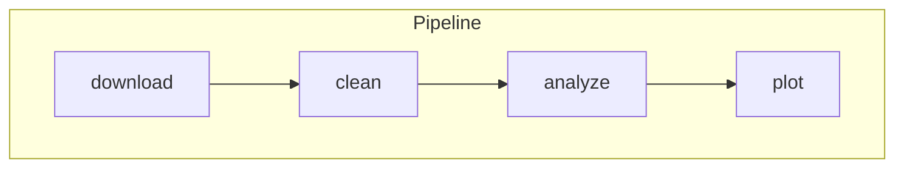
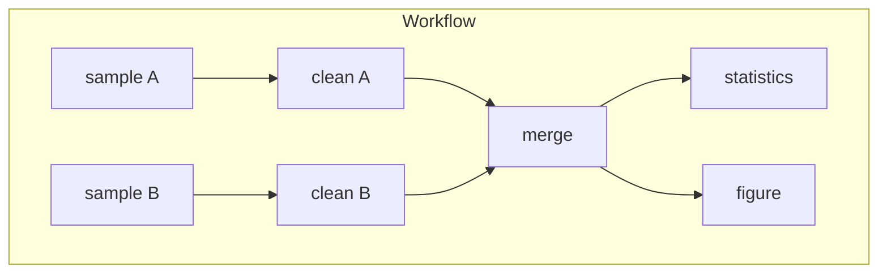

# Introduction

This page covers the ideas behind the tutorial: what Snakemake is, when it helps, how "workflow" and "pipeline" differ, and why workflows are drawn as DAGs. The [examples](README.md#examples) then put these ideas into practice.

## What Snakemake does

[Snakemake](https://snakemake.readthedocs.io/) is a workflow management system. You describe your analysis as a set of **rules** in a file called a `Snakefile`. Each rule says:

- which files it needs (**input**)
- which files it produces (**output**)
- how to turn one into the other (a **shell** command, a Python **run** block, or a script)

```python
rule transform:
    input:
        "greeting.txt",
    output:
        "shout.txt",
    shell:
        "tr '[:lower:]' '[:upper:]' < {input} > {output}"
```

You never tell Snakemake what order to run things in. Instead, you ask for a file you want, such as `shout.txt`. Snakemake then works **backwards**: it finds the rule that produces that file, checks what that rule needs, finds the rule that produces *those* files, and so on until it reaches files that already exist. From that chain it works out:

- **what needs to run**: only the steps whose outputs are missing or older than their inputs
- **in what order**: every step runs after the steps it depends on
- **what can run at the same time**: steps that don't depend on each other can run in parallel

Snakemake's syntax is an extension of Python, so you can use ordinary Python (variables, lists, functions, imports) anywhere in a `Snakefile`.

## What Snakemake is useful for

Snakemake helps when an analysis has several steps, many input files, or needs to be re-run reliably. It started in bioinformatics and is widely used there, but it works for any file-based analysis.

| Problem | How Snakemake helps |
|---|---|
| Re-running everything after a small change is slow | Only the steps affected by the change are re-run; everything else is reused ([example 3](examples/example3/) shows a re-run doing nothing) |
| The same steps must be applied to many samples | Wildcards and `expand()` write one rule that runs for every sample ([example 2](examples/example2/)) |
| Analyses are hard to reproduce months later | The `Snakefile` records every step, and each rule can pin its own conda environment or container |
| Steps could run in parallel but are run one at a time | `--cores N` runs independent jobs at once on your machine |
| Work has to move from a laptop to a cluster or the cloud | The same `Snakefile` runs on HPC schedulers such as SLURM, or in the cloud, by changing how it's launched rather than the workflow |
| It's hard to explain or check what an analysis did | Snakemake can draw the workflow as a graph and build an HTML report with results and provenance ([example 4](examples/example4/)) |
| A failed run leaves half-written files behind | Snakemake deletes incomplete outputs from failed jobs, so a rerun starts clean |

## Workflow vs. pipeline

The two words are often used interchangeably, including in Snakemake's own documentation. When people do distinguish them, the difference is about **shape**:

- **A pipeline** is a linear chain: the output of one step feeds directly into the next, like water through a pipe. *Download → clean → analyze → plot.*
- **A workflow** is the more general idea: a set of steps with dependencies between them. Steps can **branch** (one result is used by several later steps), **merge** (several results are combined), and run **in parallel** when they don't depend on each other.





Every pipeline is a workflow, but not every workflow is a pipeline. Real analyses usually start out as pipelines and turn into workflows as soon as there is more than one sample or more than one output. Snakemake handles both the same way. [Example 1](examples/example1/) is a two-step pipeline and [example 2](examples/example2/) is a branching workflow.

## Why we use DAGs to represent workflows

Snakemake represents a workflow as a **DAG**, a **directed acyclic graph**:

- **Graph**: steps (jobs) are **nodes**, and each dependency between two steps is an **edge**.
- **Directed**: every edge points one way, from the step that produces a file to the step that uses it. Data flows forward.
- **Acyclic**: there are no loops. No step can depend, directly or indirectly, on its own output.

This structure is a natural fit for a workflow, and drawing it is useful for several reasons:

1. **It guarantees there is a valid order to run things in.** Because there are no cycles, the steps can always be sorted so that each one runs after everything it needs. If a workflow accidentally contained a cycle (A needs B, and B needs A), it could never finish, and Snakemake refuses to run it.
2. **It shows what can run in parallel.** Any two nodes with no path between them are independent. In the workflow diagram above, *clean A* and *clean B* can run at the same time.
3. **It shows what a change affects.** If an input file changes, everything downstream of it in the graph is out of date and everything else isn't. This is exactly how Snakemake decides what to re-run.
4. **It makes the analysis easy to understand and check.** A picture of the graph shows at a glance how results were produced, which helps when explaining a method, reviewing someone else's work, or debugging a step that went wrong.
5. **It matches how the work actually behaves.** A workflow is a set of dependencies, not a list of commands. A list would hide the branching and merging, but a graph shows it directly.

Snakemake can draw the graph for you in a few ways, which [examples 1](examples/example1/) and [2](examples/example2/) demonstrate:

```bash
snakemake --dag | dot -Tsvg > dag.svg              # every job as its own node
snakemake --rulegraph | dot -Tsvg > rulegraph.svg  # one node per rule; easier to read for large workflows
snakemake --dag --dag-format mermaid               # Mermaid text (Snakemake 8+)
```

## Where to go next

Start with [example 0](examples/example0/) for a fully commented tour of a `Snakefile`, then work through examples 1–4 in order. Setup instructions are in the [README](README.md#getting-started).

## Jobs that use workflow automation

Building and running automated workflows is a core skill in many roles. When searching job boards, look for these titles together with tool names such as *Airflow*, *Snakemake*, *Nextflow*, or *workflow orchestration*.

| Role | How workflows are used |
|---|---|
| **Data Engineer** | Builds scheduled pipelines that move, clean, and load data into warehouses and data lakes, often with Airflow, Dagster, or Prefect |
| **Analytics Engineer** | Automates the transformations behind reports and dashboards so they refresh reliably |
| **Bioinformatician / Computational Biologist** | Runs sequencing and genomics analyses over many samples with Snakemake or Nextflow |
| **Research Software Engineer** | Builds reproducible analysis workflows for research groups, often on HPC clusters |
| **HPC / Research Computing Specialist** | Helps researchers run large workflows efficiently on supercomputers and clusters |
| **Machine Learning / MLOps Engineer** | Automates data preparation, model training, evaluation, and deployment |
| **Data Scientist** | Turns one-off notebook analyses into repeatable workflows |
| **DevOps / Platform Engineer** | Automates builds, tests, and deployments with CI/CD pipelines, and runs orchestration platforms for other teams |

Companies that publicly report using Apache Airflow are listed in its [INTHEWILD.md](https://github.com/apache/airflow/blob/main/INTHEWILD.md) file, a useful starting point for finding employers.

## Useful jobs

These organizations are known to use workflow automation and one or more of the tools in this guide. They are good places to look for the roles above. This table lists employers, not open positions, so check each organization's careers page for current openings.

| Organization | Sector | Tools | Typical roles |
|---|---|---|---|
| [Astronomer](https://www.astronomer.io/) | Software | Airflow (main commercial Airflow company) | Data Engineer, Software Engineer, Solutions Engineer |
| [Seqera](https://seqera.io/) | Software / life sciences | Nextflow (company behind Nextflow) | Software Engineer, Bioinformatician |
| [Prefect](https://www.prefect.io/) | Software | Prefect | Software Engineer, Developer Advocate |
| [Dagster Labs](https://dagster.io/) | Software | Dagster | Software Engineer, Developer Advocate |
| [Google Cloud](https://cloud.google.com/composer) | Cloud | Airflow (Cloud Composer) | Software Engineer, Cloud Engineer |
| [Amazon Web Services](https://aws.amazon.com/managed-workflows-for-apache-airflow/) | Cloud | Airflow (Managed Workflows for Apache Airflow) | Software Engineer, Solutions Architect |
| Airbnb | Technology | Airflow (where it was created) | Data Engineer |
| Spotify | Media | Luigi (created there), Airflow | Data Engineer, ML Engineer |
| Capital One, PayPal, Robinhood | Finance | Airflow | Data Engineer, ML Engineer |
| Walmart, Etsy, Wayfair, Instacart | Retail / e-commerce | Airflow | Data Engineer, Analytics Engineer |
| [Broad Institute](https://www.broadinstitute.org/) | Genomics research | WDL (created there), Cromwell | Bioinformatician, Software Engineer |
| [Wellcome Sanger Institute](https://www.sanger.ac.uk/) | Genomics research | Nextflow, nf-core | Bioinformatician, Research Software Engineer |
| [Galaxy Project](https://galaxyproject.org/) partner universities | Research / academia | Galaxy | Research Software Engineer, Bioinformatician |
| NASA Jet Propulsion Laboratory | Space / research | Airflow | Data Engineer, Software Engineer |
| University research computing and HPC centers | Research / academia | Snakemake, Nextflow, Slurm-based workflows | HPC Specialist, Research Software Engineer |
| Hospital and academic bioinformatics cores | Healthcare / research | Snakemake, Nextflow | Bioinformatician, Computational Biologist |

*Table last updated: 2026-11-24.*

## Useful links

**Scientific and data workflow managers**

- [Snakemake](https://snakemake.readthedocs.io/): documentation for the workflow manager used in this tutorial
- [Snakemake Workflow Catalog](https://snakemake.github.io/snakemake-workflow-catalog/): ready-made, community-maintained Snakemake workflows
- [Nextflow](https://www.nextflow.io/): a workflow manager widely used in bioinformatics
- [nf-core](https://nf-co.re/): curated, community-built Nextflow pipelines
- [Common Workflow Language (CWL)](https://www.commonwl.org/): an open standard for describing workflows that run on many engines
- [WDL](https://openwdl.org/): the Workflow Description Language, used in genomics
- [Galaxy](https://galaxyproject.org/): a web-based platform for building and running analyses without writing code
- [GNU Make](https://www.gnu.org/software/make/): the original file-based build tool that inspired Snakemake

**Data orchestration platforms**

- [Apache Airflow](https://airflow.apache.org/): schedules and monitors workflows written in Python; widely used in industry
- [Prefect](https://www.prefect.io/): Python workflow orchestration
- [Dagster](https://dagster.io/): orchestration built around data assets
- [Luigi](https://github.com/spotify/luigi): a Python package for building pipelines of batch jobs, from Spotify

**General and no-code automation**

- [IFTTT](https://ifttt.com/): "If This Then That". Connects apps and devices with simple rules, such as *if* a new photo is posted, *then* save it to cloud storage
- [Zapier](https://zapier.com/): connects web apps to automate everyday tasks without code
- [n8n](https://n8n.io/): an open-source workflow automation tool that you can host yourself
- [GitHub Actions](https://docs.github.com/en/actions): runs automated workflows such as tests and deployments in response to events in a GitHub repository

## References

**Snakemake**

1. Köster J, Rahmann S. Snakemake—a scalable bioinformatics workflow engine. *Bioinformatics*. 2012;28(19):2520–2522. [doi:10.1093/bioinformatics/bts480](https://doi.org/10.1093/bioinformatics/bts480). The original Snakemake paper.
2. Mölder F, Jablonski KP, Letcher B, et al. Sustainable data analysis with Snakemake. *F1000Research*. 2021;10:33. [doi:10.12688/f1000research.29032.2](https://doi.org/10.12688/f1000research.29032.2). The current reference paper; cite this when you use Snakemake.
3. [Snakemake documentation](https://snakemake.readthedocs.io/) and its [official tutorial](https://snakemake.readthedocs.io/en/stable/tutorial/tutorial.html).

**Other workflow systems**

4. Di Tommaso P, Chatzou M, Floden EW, et al. Nextflow enables reproducible computational workflows. *Nature Biotechnology*. 2017;35:316–319. [doi:10.1038/nbt.3820](https://doi.org/10.1038/nbt.3820).
5. Ewels PA, Peltzer A, Fillinger S, et al. The nf-core framework for community-curated bioinformatics pipelines. *Nature Biotechnology*. 2020;38:276–278. [doi:10.1038/s41587-020-0439-x](https://doi.org/10.1038/s41587-020-0439-x).
6. Crusoe MR, Abeln S, Iosup A, et al. Methods included: standardizing computational reuse and portability with the Common Workflow Language. *Communications of the ACM*. 2022;65(6):54–63. [doi:10.1145/3486897](https://doi.org/10.1145/3486897).
7. Afgan E, Baker D, Batut B, et al. The Galaxy platform for accessible, reproducible and collaborative biomedical analyses: 2018 update. *Nucleic Acids Research*. 2018;46(W1):W537–W544. [doi:10.1093/nar/gky379](https://doi.org/10.1093/nar/gky379).
8. Beauchemin M. [Airflow: a workflow management platform](https://medium.com/airbnb-engineering/airflow-a-workflow-management-platform-46318b977fd8). *Airbnb Engineering & Data Science* blog, 2015. The post that introduced Airflow.

**Reviews and comparisons**

9. Wratten L, Wilm A, Göke J. Reproducible, scalable, and shareable analysis pipelines with bioinformatics workflow managers. *Nature Methods*. 2021;18:1161–1168. [doi:10.1038/s41592-021-01254-9](https://doi.org/10.1038/s41592-021-01254-9).
10. Leipzig J. A review of bioinformatic pipeline frameworks. *Briefings in Bioinformatics*. 2017;18(3):530–536. [doi:10.1093/bib/bbw020](https://doi.org/10.1093/bib/bbw020).

**Reproducible research**

11. Sandve GK, Nekrutenko A, Taylor J, Hovig E. Ten simple rules for reproducible computational research. *PLoS Computational Biology*. 2013;9(10):e1003285. [doi:10.1371/journal.pcbi.1003285](https://doi.org/10.1371/journal.pcbi.1003285).
12. Wilson G, Aruliah DA, Brown CT, et al. Best practices for scientific computing. *PLoS Biology*. 2014;12(1):e1001745. [doi:10.1371/journal.pbio.1001745](https://doi.org/10.1371/journal.pbio.1001745).

**Background**

13. [Directed acyclic graph](https://en.wikipedia.org/wiki/Directed_acyclic_graph). *Wikipedia*. An overview of the graph structure Snakemake uses to represent workflows.
