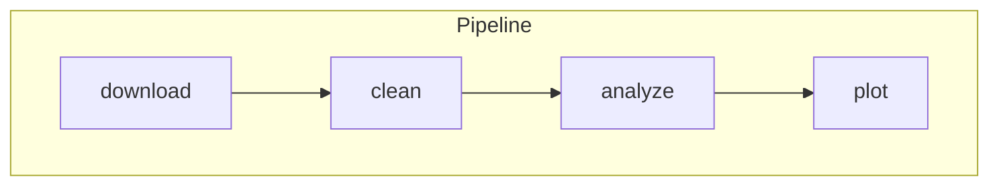
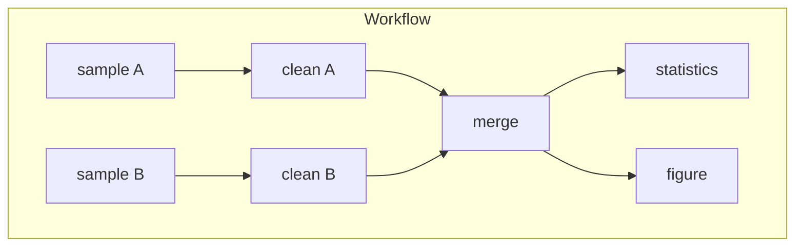

# Introduction

This page covers the ideas behind the tutorial: what Snakemake is, when it helps, how "workflow" and "pipeline" differ, and why workflows are drawn as DAGs. The [examples](README.md#examples) then put these ideas into practice.

## What Snakemake does

[Snakemake](https://snakemake.readthedocs.io/) is a workflow management system. You describe your analysis as a set of **rules** in a file called a `Snakefile`. Each rule says:

- which files it needs (**input**)
- which files it produces (**output**)
- how to turn one into the other (a **shell** command, a Python **run** block, or a script)

```python
rule transform:
    input:
        "greeting.txt",
    output:
        "shout.txt",
    shell:
        "tr '[:lower:]' '[:upper:]' < {input} > {output}"
```

You never tell Snakemake what order to run things in. Instead, you ask for a file you want, such as `shout.txt`. Snakemake then works **backwards**: it finds the rule that produces that file, checks what that rule needs, finds the rule that produces *those* files, and so on until it reaches files that already exist. From that chain it works out:

- **what needs to run**: only the steps whose outputs are missing or older than their inputs
- **in what order**: every step runs after the steps it depends on
- **what can run at the same time**: steps that don't depend on each other can run in parallel

Snakemake's syntax is an extension of Python, so you can use ordinary Python (variables, lists, functions, imports) anywhere in a `Snakefile`.

## What Snakemake is useful for

Snakemake helps when an analysis has several steps, many input files, or needs to be re-run reliably. It started in bioinformatics and is widely used there, but it works for any file-based analysis.

| Problem | How Snakemake helps |
|---|---|
| Re-running everything after a small change is slow | Only the steps affected by the change are re-run; everything else is reused ([example 3](example3/) shows a re-run doing nothing) |
| The same steps must be applied to many samples | Wildcards and `expand()` write one rule that runs for every sample ([example 2](example2/)) |
| Analyses are hard to reproduce months later | The `Snakefile` records every step, and each rule can pin its own conda environment or container |
| Steps could run in parallel but are run one at a time | `--cores N` runs independent jobs at once on your machine |
| Work has to move from a laptop to a cluster or the cloud | The same `Snakefile` runs on HPC schedulers such as SLURM, or in the cloud, by changing how it's launched rather than the workflow |
| It's hard to explain or check what an analysis did | Snakemake can draw the workflow as a graph and build an HTML report with results and provenance ([example 4](example4/)) |
| A failed run leaves half-written files behind | Snakemake deletes incomplete outputs from failed jobs, so a rerun starts clean |

## Workflow vs. pipeline

The two words are often used interchangeably, including in Snakemake's own documentation. When people do distinguish them, the difference is about **shape**:

- **A pipeline** is a linear chain: the output of one step feeds directly into the next, like water through a pipe. *Download → clean → analyze → plot.*
- **A workflow** is the more general idea: a set of steps with dependencies between them. Steps can **branch** (one result is used by several later steps), **merge** (several results are combined), and run **in parallel** when they don't depend on each other.





Every pipeline is a workflow, but not every workflow is a pipeline. Real analyses usually start out as pipelines and turn into workflows as soon as there is more than one sample or more than one output. Snakemake handles both the same way. [Example 1](example1/) is a two-step pipeline and [example 2](example2/) is a branching workflow.

## Why we use DAGs to represent workflows

Snakemake represents a workflow as a **DAG**, a **directed acyclic graph**:

- **Graph**: steps (jobs) are **nodes**, and each dependency between two steps is an **edge**.
- **Directed**: every edge points one way, from the step that produces a file to the step that uses it. Data flows forward.
- **Acyclic**: there are no loops. No step can depend, directly or indirectly, on its own output.

This structure is a natural fit for a workflow, and drawing it is useful for several reasons:

1. **It guarantees there is a valid order to run things in.** Because there are no cycles, the steps can always be sorted so that each one runs after everything it needs. If a workflow accidentally contained a cycle (A needs B, and B needs A), it could never finish, and Snakemake refuses to run it.
2. **It shows what can run in parallel.** Any two nodes with no path between them are independent. In the workflow diagram above, *clean A* and *clean B* can run at the same time.
3. **It shows what a change affects.** If an input file changes, everything downstream of it in the graph is out of date and everything else isn't. This is exactly how Snakemake decides what to re-run.
4. **It makes the analysis easy to understand and check.** A picture of the graph shows at a glance how results were produced, which helps when explaining a method, reviewing someone else's work, or debugging a step that went wrong.
5. **It matches how the work actually behaves.** A workflow is a set of dependencies, not a list of commands. A list would hide the branching and merging, but a graph shows it directly.

Snakemake can draw the graph for you in a few ways, which [examples 1](example1/) and [2](example2/) demonstrate:

```bash
snakemake --dag | dot -Tsvg > dag.svg              # every job as its own node
snakemake --rulegraph | dot -Tsvg > rulegraph.svg  # one node per rule; easier to read for large workflows
snakemake --dag --dag-format mermaid               # Mermaid text (Snakemake 8+)
```

## Where to go next

Start with [example 0](example0/) for a fully commented tour of a `Snakefile`, then work through examples 1–4 in order. Setup instructions are in the [README](README.md#getting-started).
