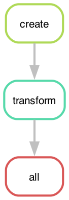

# Example 1 — Run a workflow and render its DAG

A minimal two-rule workflow:

```
create (greeting.txt) ─► transform (shout.txt) ─► all
```



*The job DAG, drawn with `snakemake --dag | dot -Tpng`.*

- `create` writes `hello river` to `greeting.txt`.
- `transform` upper-cases it into `shout.txt`.
- `all` is the first rule, so it is the default target. It asks for `shout.txt`, and Snakemake works backwards to figure out that `create` must run first.

## Run it

```bash
conda activate snakemake-tutorial
cd examples/example1
snakemake -n -p --cores 1                  # dry run: show the plan and commands
snakemake --cores 1                        # run it
cat shout.txt                              # HELLO RIVER
snakemake --dag | dot -Tsvg > dag.svg      # draw the job DAG
```

Or open [`example1.ipynb`](example1.ipynb) to run each step from a notebook.

## Files

| File | Purpose |
|---|---|
| [`Snakefile`](Snakefile) | The workflow |
| [`example1.ipynb`](example1.ipynb) | Notebook walk-through |
